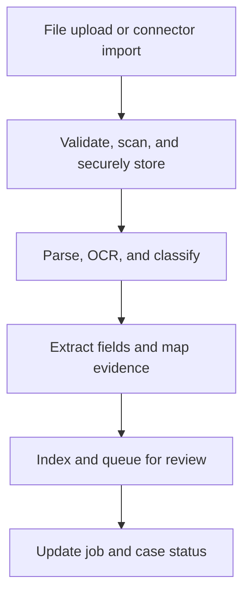
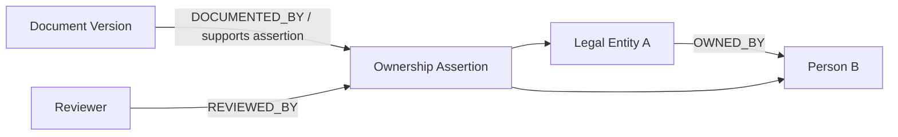
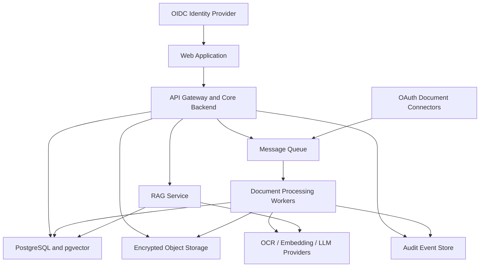
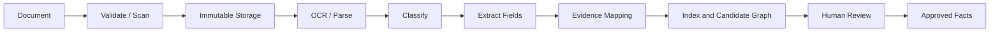

# FinGraph — AI-Powered Fintech Document Intelligence & Compliance Platform

**Project Requirements & Technical Architecture Specification**  
**Version:** 1.0  
**Date:** October 17, 2026  
**Domains:** Fintech · Document Intelligence · RAG · Knowledge Graph · Full-Stack SaaS · OAuth 2.0 · Compliance

---

## 1. Project Overview

**Project name:** FinGraph  
**Project type:** B2B SaaS / Enterprise Document Intelligence and Compliance Operations Platform  
**Industry:** Financial Technology, Banking, Risk Management, Regulatory Compliance, Enterprise AI

**One-sentence description:** FinGraph is a secure, AI-powered fintech platform that ingests financial and compliance documents, extracts structured information, connects related entities through a knowledge graph, and provides evidence-grounded insights using Retrieval-Augmented Generation (RAG).

### Detailed description

FinGraph helps fintech companies, financial institutions, payment providers, and compliance teams centralize document-heavy workflows. It combines six capabilities:

1. **Document ingestion:** Collect, validate, classify, parse, and version financial documents.
2. **RAG:** Answer questions using authorized source material with traceable citations.
3. **Knowledge graph:** Connect companies, people, ownership, policies, documents, and evidence.
4. **Full-stack application:** Provide case management, dashboards, review tools, and APIs.
5. **OAuth and identity:** Secure organizational access and authorized external integrations.
6. **Compliance:** Support document verification, policy checks, approval workflows, and audit evidence.

### Primary business use case

The initial product focuses on **Know Your Customer (KYC), Know Your Business (KYB), and compliance evidence management**.

For example, a fintech onboarding a business customer may need to review incorporation documents, beneficial ownership information, financial statements, and internal policies. Instead of manually reading every document and copying information into separate systems, a compliance analyst can:

1. Upload documents or import them through authorized integrations.
2. Automatically classify documents and extract relevant fields.
3. Identify companies, beneficial owners, directors, and their relationships.
4. Detect missing, inconsistent, or outdated information.
5. Ask natural-language questions about the submitted evidence.
6. Review AI-generated findings with direct references to source documents.
7. Approve or reject extracted facts and record defensible audit evidence.

The system assists with document review and compliance investigation. **Final regulatory decisions remain the responsibility of authorized human reviewers.**

### Scope and assumptions

The initial input consists of technology and industry keywords. The following are **proposed design assumptions**, not facts about an existing product.

| Dimension | Proposed assumption |
|---|---|
| Initial market | US-based fintechs, payment companies, and financial institutions |
| Primary customers | Compliance and risk operations teams |
| Delivery model | Multi-tenant B2B SaaS |
| First use case | KYB onboarding and evidence review |
| Primary input | PDFs, scans, financial statements, corporate records, and policies |
| AI approach | Document extraction, hybrid retrieval, RAG, entity resolution |
| Graph approach | Evidence-backed business-entity relationships |
| Geographic scope | United States initially; EU support later |
| Decision authority | Human-reviewed compliance decisions |
| Exclusions | Payment execution, bank ledger management, regulatory filing submission, autonomous account approval |

**Business purpose:** Reduce the time and inconsistency involved in financial document and compliance evidence reviews while improving traceability.

**Project value:** A unified evidence layer across documents, extracted facts, relationships, search, and human decisions.

---

## 2. Business Context

### Industry background

Financial institutions collect, review, and maintain customer and business-relationship information under applicable risk-based due diligence programs. Document processing, customer lifecycle management, and identity orchestration are established enterprise software categories. Representative products include Fenergo (client lifecycle/KYC workflows), Ocrolus (financial-document extraction/verification), and Alloy (identity/risk orchestration).

FinGraph's proposed differentiation is to combine **document processing, explainable retrieval, entity relationships, and reviewer-controlled compliance evidence** in one focused workflow.

### Existing operational challenges

| Challenge | Existing approach | FinGraph solution |
|---|---|---|
| Fragmented documentation | Documents scattered across cloud storage and operational systems | Centralized ingestion and indexing |
| Manual extraction | Analysts re-enter customer details | Structured AI-assisted extraction |
| Disconnected business relationships | Ownership tracked in spreadsheets | Knowledge graph with evidence-backed relationships |
| Slow investigations | Analysts search documents individually | Hybrid search and grounded RAG |
| Inconsistent reviews | Different analysts follow different procedures | Standardized, versioned review workflows |
| Limited auditability | Decisions and evidence stored separately | Traceable evidence and immutable audit events |
| Integration overhead | Custom import scripts and manual exports | OAuth-secured connectors, APIs, and webhooks |

### Business objectives and expected benefits

- Reduce manual document classification and data transcription.
- Improve consistency and completeness of extracted customer information.
- Help analysts investigate complex entity relationships.
- Enable rapid source-grounded search and questioning.
- Standardize case reviews and approvals.
- Reduce effort to assemble audit-ready evidence.
- Measure processing quality, review time, and operating cost.

The expected value is faster, better-supported reviews, **not automatic proof of regulatory compliance**.

---

## 3. Target Users & Stakeholders

| User | Responsibilities and goals | Pain points and system interaction |
|---|---|---|
| **Compliance Analyst** | Review customer evidence, investigate discrepancies, document decisions | Uses document review, RAG search, graph exploration, case management |
| **Risk Manager** | Oversee high-risk cases, approve escalations, monitor review quality | Uses dashboards, assignment queues, approval records, analytics |
| **Customer Onboarding Specialist** | Collect customer documents and resolve missing information | Uploads files, checks ingestion status, requests corrections |
| **Internal Auditor** | Evaluate evidence, access history, and compliance processes | Uses read-only case histories and audit exports |
| **Platform Administrator** | Manage organizations, users, permissions, integrations, retention settings | Uses the administration console |
| **Integration Developer** | Connect business systems and automate document submissions | Uses REST APIs, OAuth integrations, webhooks, developer documentation |

Other stakeholders include security, privacy/legal, ML engineering, product leadership, and customer support.

---

## 4. Functional Requirements

Priorities: **Must Have** = MVP baseline; **Should Have** = next release; **Could Have** = optional future capabilities.

### 4.1 Authentication, authorization, and organization management

| ID | Requirement | Business value | Priority | Role |
|---|---|---|---|---|
| IAM-01 | Support OpenID Connect SSO and secure session management | Secure enterprise access | Must Have | All users |
| IAM-02 | Implement tenant-scoped RBAC and document/case-level authorization | Prevent unauthorized disclosure | Must Have | Admin |
| IAM-03 | Support organization creation, user invitations, and account deactivation | User lifecycle management | Must Have | Admin |
| IAM-04 | Support MFA through the organization's identity provider | Reduce account compromise risk | Must Have | All users |
| IAM-05 | Support enterprise provisioning and configurable access policies | Scale enterprise administration | Should Have | Admin |

### 4.2 Document ingestion and extraction

| ID | Requirement | Business value | Priority | Role |
|---|---|---|---|---|
| DOC-01 | Upload supported PDF, PNG, JPEG, and document files | Centralized intake | Must Have | Onboarding |
| DOC-02 | Perform file validation, malware scanning, checksum calculation, duplicate detection | Safer, reliable intake | Must Have | Platform |
| DOC-03 | Queue asynchronous ingestion and expose processing status | Reliable bulk processing | Must Have | Analyst |
| DOC-04 | Extract text, page layouts, tables, and metadata using parsers/OCR | Convert files into searchable data | Must Have | Analyst |
| DOC-05 | Classify financial and compliance document types | Reduce document sorting work | Must Have | Analyst |
| DOC-06 | Extract configurable structured fields with source references | Reduce manual entry | Must Have | Analyst |
| DOC-07 | Support document versioning and replacement history | Maintain evidence provenance | Must Have | Analyst |
| DOC-08 | Support batch imports and scheduled reprocessing | Operational efficiency | Should Have | Onboarding |

Initially supported document categories may include certificates of incorporation, beneficial ownership declarations, bank statements, tax forms, corporate ownership charts, and internal compliance policies. Extraction schemas should be tailored to each category.

### 4.3 Knowledge graph and entity intelligence

| ID | Requirement | Business value | Priority | Role |
|---|---|---|---|---|
| KG-01 | Create normalized entities for organizations and individuals | Build consistent business records | Must Have | Analyst |
| KG-02 | Capture typed, evidence-backed ownership and management relationships | Support beneficial ownership investigations | Must Have | Analyst |
| KG-03 | Store confidence, source, effective dates, and validation status on extracted assertions | Explain and verify relationships | Must Have | Analyst |
| KG-04 | Identify possible duplicate entities and conflicting information | Improve review quality | Should Have | Analyst |
| KG-05 | Display an interactive relationship graph | Make complex structures understandable | Should Have | Analyst |
| KG-06 | Support multi-hop graph investigations | Analyze complicated ownership structures | Could Have | Risk Manager |

The MVP may represent graph relationships in relational tables. A dedicated graph database is not required initially.

### 4.4 RAG and intelligent search

| ID | Requirement | Business value | Priority | Role |
|---|---|---|---|---|
| AI-01 | Support keyword and semantic document search | Faster information discovery | Must Have | Analyst |
| AI-02 | Answer natural-language questions from authorized case evidence | Reduce investigation effort | Must Have | Analyst |
| AI-03 | Return source-document citations, page numbers, and relevant excerpts | Verifiable findings | Must Have | Analyst |
| AI-04 | Abstain or report insufficient evidence when reliable support is unavailable | Reduce unsupported claims | Must Have | Analyst |
| AI-05 | Enforce authorization before retrieval and model generation | Prevent cross-tenant leakage | Must Have | Platform |
| AI-06 | Maintain model, prompt, retrieval, and source-version metadata | AI auditability | Must Have | Auditor |
| AI-07 | Add knowledge-graph-assisted retrieval | Improve relationship-based investigation | Should Have | Analyst |
| AI-08 | Support comparison across document versions and time periods | Detect changes and discrepancies | Should Have | Analyst |

### 4.5 Case management, compliance, and reporting

| ID | Requirement | Business value | Priority | Role |
|---|---|---|---|---|
| CASE-01 | Create KYB cases and assign reviewers | Organize work | Must Have | Onboarding |
| CASE-02 | Configure required-document checklists by case type | Reduce incomplete submissions | Must Have | Risk Manager |
| CASE-03 | Review, correct, approve, or reject extracted facts | Maintain human control | Must Have | Analyst |
| CASE-04 | Record evidence-supported review outcomes and rationale | Explain decisions | Must Have | Analyst |
| CASE-05 | Provide case status, workload, and exception dashboards | Operational visibility | Must Have | Risk Manager |
| CASE-06 | Generate versioned audit-evidence packages | Simplify audit preparation | Must Have | Auditor |
| CASE-07 | Trigger in-app notifications for failed ingestion and review assignments | Reduce delays | Should Have | Analyst |
| CASE-08 | Support policy-rule versioning and configurable escalation workflows | Improve governance | Should Have | Risk Manager |

### 4.6 APIs, integrations, and administration

| ID | Requirement | Business value | Priority | Role |
|---|---|---|---|---|
| INT-01 | Provide versioned REST APIs for cases, documents, and results | Enterprise integration | Must Have | Developer |
| INT-02 | Support secure webhook delivery and retry handling | Workflow automation | Must Have | Developer |
| INT-03 | Connect to one external document repository through OAuth | Reduce manual document transfers | Should Have | Admin |
| INT-04 | Manage OAuth consent, token refresh, expiration, and revocation | Secure integration lifecycle | Should Have | Admin |
| GOV-01 | Record append-only security and case audit events | Accountability | Must Have | Auditor |
| GOV-02 | Enforce retention, deletion, and legal-hold policies | Govern sensitive information | Must Have | Admin |
| GOV-03 | Provide tenant-level configuration, usage metrics, and operational alerts | Sustainable operations | Must Have | Admin |
| GOV-04 | Support data exports and controlled evidence sharing | Portability and review | Should Have | Auditor |

---

## 5. Non-Functional Requirements

All numerical values are **proposed engineering targets**, not measured performance or contractual commitments.

| Category | Proposed target |
|---|---|
| Availability | 99.9% monthly availability for the core application |
| UI performance | p95 page/API read latency ≤ 2 seconds for common operations under defined load |
| Search performance | p95 ≤ 3 seconds for typical authorized search requests |
| RAG response | p95 ≤ 15 seconds for normal single-case questions |
| Ingestion throughput | Initial capacity of 10,000 documents/day, using horizontal worker scaling |
| Document processing | p95 within 5 minutes for a representative 50-page supported PDF |
| Initial capacity | 100 organizations, with tenant quotas and staged capacity growth |
| Scalability | Stateless API services and independently scalable background workers |
| Reliability | At-least-once task delivery, idempotent processing, bounded retries, dead-letter queues |
| Disaster recovery | RPO ≤ 1 hour and RTO ≤ 4 hours |
| Encryption | TLS 1.2+ in transit, modern encryption at rest, managed keys |
| Access control | Tenant, case, document authorization for all data and AI retrieval paths |
| Accessibility | WCAG 2.2 AA design target |
| Observability | Structured logs, metrics, distributed traces, actionable alerts |
| Maintainability | Automated CI/CD, API versioning, integration tests, recovery procedures |
| Data retention | Configurable schedules based on customer policy, law, and legal holds |
| Privacy | Minimize unnecessary PII and sensitive data in telemetry |
| Cost control | Per-tenant storage, OCR, model-token, and processing budgets |

### Capacity considerations

- **Document ingestion:** Asynchronous, compute-heavy, and sensitive to scan quality. Use bounded worker pools instead of blocking HTTP requests.
- **RAG retrieval:** Latency-sensitive. Use precomputed embeddings, metadata filtering, efficient keyword/vector indexes, and bounded context windows.
- **Graph traversal:** Potentially expensive for large ownership networks. Limit traversal depth, visited nodes, and query execution time.
- **Testing:** Use representative document length, OCR complexity, permission structures, and tenant distributions.

---

## 6. Core User Workflows

### WF-01 — Document ingestion

**Actor:** Onboarding Specialist  
**Trigger:** A customer document is submitted.  
**Preconditions:** The user has access to an active case; the file format is supported.



**Main flow:** Create an ingestion job; validate the file; store an immutable source version; process content; generate structured extraction candidates; make results available for review.

**Alternative flows:** Link detected duplicates to an existing document; retain an unsupported file as unprocessed evidence if policy permits.

**Exceptions:** Quarantine malware; flag unreadable files for resubmission; retry transient processing failures with limits; expose terminal failures in the UI.

**Expected outcome:** Searchable document version with linked extraction candidates and processing history.

### WF-02 — OAuth-connected document import

**Actor:** Platform Administrator  
**Trigger:** Organization requests a cloud document integration.  
**Preconditions:** Provider supported; authorized user able to grant access.

1. Administrator selects the provider.
2. FinGraph starts OAuth Authorization Code with PKCE.
3. Provider authenticates the user and presents applicable consent.
4. FinGraph validates the callback and exchanges the code server-side.
5. Tokens are stored securely with scopes and expiration metadata.
6. Authorized files enter a queued, resumable synchronization process.
7. Synchronization and connector health are visible to administrators.

**Alternative/exception:** Denied consent, expired credentials, or revocation trigger a reauthorization or disconnected state. Previously imported records remain subject to retention and deletion policies.

**Expected outcome:** Authorized document import without collecting external-service passwords.

### WF-03 — Compliance evidence review

**Actor:** Compliance Analyst  
**Trigger:** A case enters the review queue.  
**Preconditions:** Required evidence submitted or missing evidence explicitly tracked.

1. Open the assigned case.
2. Compare extracted facts with their source documents.
3. Inspect proposed company and person relationships.
4. Investigate conflicts and missing information.
5. Correct, approve, or reject extracted facts.
6. Record a recommendation and rationale.
7. Escalate high-risk or unresolved cases according to customer policy.

**Alternative:** Request additional customer documents.

**Exceptions:** Preserve conflicting claims and source references until reconciliation; do not treat AI confidence as independent verification.

**Expected outcome:** Evidence-supported review record with a human decision.

### WF-04 — RAG-assisted investigation

**Actor:** Compliance Analyst  
**Trigger:** Analyst asks a natural-language question.  
**Preconditions:** Analyst is permitted to access the case and source documents.

Example: *Which individuals are listed as beneficial owners of this company, and which documents support those relationships?*

1. Authorize the request and source scope.
2. Retrieve relevant authorized passages.
3. Optionally traverse validated graph relationships.
4. Generate a grounded response using the selected evidence.
5. Validate and attach document-version citations.
6. Identify missing, contradictory, or insufficient evidence if necessary.

**Expected outcome:** Independently verifiable research response, not an autonomous compliance decision.

### WF-05 — Audit evidence export

**Actor:** Internal Auditor  
**Trigger:** Authorized audit evidence request.  
**Preconditions:** Auditor has required read permissions.

1. Select the case and permitted evidence scope.
2. Assemble case metadata and source references.
3. Include approved facts, decisions, rationale, timestamps, and policy versions.
4. Apply export restrictions and legal-hold policies.
5. Create a versioned evidence package and audit the export activity.

**Expected outcome:** Controlled, reconstructible audit evidence package.

---

## 7. Use Cases and User Stories

| Story | User story | Key acceptance criteria |
|---|---|---|
| US-01 | As an onboarding specialist, I want to upload customer documents so that compliance reviewers have the required evidence. | Valid uploads create case-linked documents/jobs; malicious/invalid files are rejected or quarantined; status is visible. |
| US-02 | As a compliance analyst, I want to review extracted company details so that I do not need to re-enter every field. | Each value exposes its source; edits preserve prior values; approvals record reviewer/timestamp. |
| US-03 | As a compliance analyst, I want to see ownership relationships so that I can investigate complex legal entities. | Relationships have sources and validation status; unverified edges are distinguishable; inaccessible records are hidden. |
| US-04 | As a compliance analyst, I want AI answers supported by citations so that I can verify findings. | Citations resolve to accessible source versions; unsupported conclusions trigger abstention. |
| US-05 | As a risk manager, I want an approval workflow so that high-risk cases receive appropriate oversight. | Valid state transitions; required approvals cannot be bypassed; rationale retained. |
| US-06 | As an auditor, I want an export of case history so that I can reconstruct decisions. | Authorized evidence and events included; export metadata and access logged. |
| US-07 | As an administrator, I want to revoke a provider connection so that unauthorized future imports stop. | Future sync stops; credentials invalidated/deleted as appropriate; existing records follow retention rules. |

### Detailed acceptance scenario — US-04

```gherkin
Given an authenticated compliance analyst
And a case containing three approved documents
And the analyst has access to only two documents

When the analyst asks a question about company ownership

Then retrieval must only search authorized evidence
And each factual answer must include source citations
And each citation must identify its document version
And inaccessible evidence must not appear in the answer

When the authorized documents do not support the answer

Then the platform must indicate insufficient evidence
And must not invent an ownership relationship
```

---

## 8. Data Requirements and Conceptual Data Model

### Core entities

| Entity | Important attributes |
|---|---|
| Organization/Tenant | Tenant ID, name, configuration, retention policy |
| User | User ID, identity-provider subject, roles, tenant ID, status |
| Compliance Case | Case ID, customer ID, type, risk status, reviewer, timestamps |
| Document | Document ID, tenant/case ID, type, classification, current version |
| Document Version | Version ID, storage reference, checksum, upload time, processing status |
| Document Chunk | Chunk ID, version ID, text, page/section references, embedding reference, ACL metadata |
| Legal Entity | Entity ID, legal name, registration jurisdiction, identifier, status |
| Individual | Person ID, permitted identity attributes, validation status |
| Relationship Assertion | Source/target entities, type, validity dates, evidence reference |
| Extracted Fact | Fact ID, field type, candidate value, confidence, evidence reference, review status |
| Compliance Policy | Policy ID, jurisdiction, version, effective dates, case types |
| Review Decision | Decision ID, reviewer, result, rationale, policy version, timestamp |
| OAuth Connection | Provider, scopes, status, expiration, secure token reference, tenant ID |
| AI Interaction | Query ID, requester, source/version references, model version, response status |
| Audit Event | Event ID, actor, action, resource, timestamp, correlation ID, integrity metadata |

Every customer-owned record must have a consistent tenant ownership boundary.

### Conceptual relationship model



The model is illustrative; the assertion, not the company/person node, is the primary evidence-bearing record. Graph predicates may include `OWNED_BY`, `DIRECTOR_OF`, `SUBSIDIARY_OF`, `DOCUMENTED_BY`, `SATISFIES_REQUIREMENT`, and `REVIEWED_BY`.

### Data lifecycle

`Created → Validated → Stored → Processed → Indexed → Reviewed → Active → Archived/Deleted`

Derived data (embeddings, chunks, graph assertions, cached AI results) retains a reference to the source document version. Retention, deletion, and permission changes must propagate to derivative representations.

### Ownership, validation, and sensitivity

- **Ownership:** Customer controls submitted business data subject to contractual and legal terms.
- **Validation:** Typed schemas, identifier formats, required fields, referential integrity, and duplicate detection.
- **Temporal correctness:** Track when relationships were valid separately from when they were discovered.
- **Sensitive information:** Protect PII, beneficial-owner information, account details, tax identifiers, and confidential corporate records.
- **Audit:** Track meaningful changes, actors, timestamps, source versions, and review outcomes.
- **Reporting:** Prefer aggregated metrics without unnecessary document-content replication.

---

## 9. API & Integration Requirements

### 9.1 Proposed REST endpoints

| Method | Endpoint | Purpose |
|---|---|---|
| `POST` | `/v1/cases` | Create a compliance case |
| `GET` | `/v1/cases/{id}` | Retrieve an authorized case |
| `POST` | `/v1/documents/uploads` | Obtain a short-lived upload URL |
| `POST` | `/v1/documents` | Register a document and start processing |
| `GET` | `/v1/ingestion-jobs/{id}` | Retrieve processing status |
| `GET` | `/v1/documents/{id}/extractions` | Retrieve proposed fields |
| `POST` | `/v1/extracted-facts/{id}/reviews` | Approve/correct/reject a fact |
| `GET` | `/v1/entities/{id}/relationships` | Query permitted relationships |
| `POST` | `/v1/cases/{id}/questions` | Ask an evidence-grounded RAG question |
| `GET` | `/v1/audit/exports/{id}` | Retrieve an authorized audit export |
| `POST` | `/v1/connections/{provider}/authorize` | Start external OAuth connection |

All endpoints enforce resource authorization independently; a known ID is not evidence of permission.

### 9.2 Example asynchronous response

```json
{
  "document_id": "doc_28491",
  "job_id": "job_76284",
  "status": "queued",
  "case_id": "case_12345",
  "status_url": "/v1/ingestion-jobs/job_76284"
}
```

Return `202 Accepted` after durably accepting an ingestion request.

API standards: OpenAPI documentation, schema validation, pagination, rate limiting, correlation IDs, structured error responses, versioning, and appropriate `Idempotency-Key` support. Authorization errors must not reveal inaccessible resources.

### 9.3 External integrations

| Integration | Data exchanged and direction | Authentication | Failure handling |
|---|---|---|---|
| Cloud document repository | Authorized files and metadata → FinGraph | OAuth 2.0 | Token refresh, incremental sync, retries, revocation |
| Enterprise identity provider | Identity assertions → FinGraph | OIDC | Session expiration, reauthentication |
| KYC/KYB provider | Optional verified entity/screening data → FinGraph | Provider-supported OAuth or API auth | Rate limits, timeout, reconciliation |
| Customer operations platform | Case status and review results ↔ platform | OAuth client credentials or signed service credentials | Idempotency, reconciliation |
| Notification system | Assignment/workflow events → notification provider | Service credentials | Queue and retry |
| AI/OCR service | Minimized authorized inputs → provider; results → FinGraph | Managed service identity | Quotas, timeouts, bounded retries |

### 9.4 Event-driven contracts

```text
document.uploaded
document.validation_failed
document.processing_started
document.processed
document.processing_failed
extraction.review_required
extraction.approved
extraction.rejected
entity.relationship_changed
case.review_assigned
case.review_completed
connection.revoked
audit.export_created
```

Events include unique event IDs, tenant context, event type, timestamp, resource reference, schema version, and correlation ID. Externally delivered webhooks require signatures, bounded retries, deduplication, and dead-letter handling.

---

## 10. Technical Architecture

### 10.1 Architecture approach

Use a **modular application backend with asynchronous document/AI workers** and managed cloud infrastructure. This avoids premature microservice fragmentation while isolating long-running work.



### 10.2 Technology recommendations

| Layer | Suggested technology | Rationale |
|---|---|---|
| Frontend | React, Next.js, TypeScript | Enterprise UI and reusable components |
| Backend | TypeScript/NestJS or Java/Spring Boot | Structured APIs and business workflows |
| AI workers | Python, FastAPI, worker framework | Document processing/AI ecosystem |
| Primary database | PostgreSQL | Transactional consistency and relational modeling |
| Vector search | PostgreSQL + pgvector initially | Operational simplicity and tenant-aware retrieval |
| Graph representation | PostgreSQL nodes/edges initially | Bounded traversal for MVP |
| Future graph store | Neo4j or managed graph store | Complex traversals when justified |
| Object storage | S3-compatible encrypted storage | Durable versioned documents |
| Queue | SQS, RabbitMQ, or equivalent | Retryable asynchronous work |
| Cache | Redis or managed equivalent | Rate limiting, safe metadata cache, transient state |
| Text search | PostgreSQL full-text search initially | Hybrid retrieval |
| Future search | OpenSearch or equivalent | Scaled dedicated search |
| Authentication | Enterprise OIDC provider | SSO and centralized identity |
| Infrastructure | AWS, Azure, or GCP | Managed, scalable services |
| CI/CD | GitHub Actions or equivalent | Automated builds/tests/deployments |
| Observability | OpenTelemetry with log/metrics/traces backend | Cross-service diagnostics |

### 10.3 Backend modules

1. **Identity and Tenant:** Users, roles, membership, authorization policies.
2. **Document:** Metadata, upload/download, versioning, retention.
3. **Ingestion Orchestrator:** Durable jobs, processing states, retries, failure recovery.
4. **Extraction:** Classification, schema extraction, source mapping.
5. **Knowledge Graph:** Entity normalization and provenance-backed relationships.
6. **Retrieval and RAG:** Hybrid search, access-aware retrieval, grounded answers.
7. **Compliance Case:** Review checklists, approvals, decisions.
8. **Integration:** OAuth connections, sync, APIs, webhooks.
9. **Audit and Governance:** Audit events, legal holds, controlled exports.

### 10.4 Ingestion pipeline



Each processing stage records status, duration, parser/model version, error type, and input version. Reprocessing creates versioned derivatives instead of silently mutating approved evidence.

### 10.5 RAG indexing and question answering

**Indexing:** Parse source documents into stable sections with page/span references; attach tenant/case/document version/ACL metadata; create embeddings and text indexes.

**Question answering:**

1. Authenticate and authorize the user.
2. Determine permitted case/document scope.
3. Filter access **before** hybrid retrieval.
4. Retrieve keyword and vector matches.
5. Optionally expand from verified graph relationships.
6. Rerank and deduplicate evidence.
7. Generate a bounded answer from explicitly untrusted source content.
8. Validate citation references and output constraints.
9. Return grounded response or insufficient-evidence result.
10. Log appropriate provenance/usage metadata.

Authorization must not rely on the language model following a prompt.

### 10.6 Relationship table example

```sql
CREATE TABLE entity_relationships (
    id UUID PRIMARY KEY,
    tenant_id UUID NOT NULL,
    source_entity_id UUID NOT NULL,
    target_entity_id UUID NOT NULL,
    relationship_type VARCHAR(64) NOT NULL,
    evidence_document_version_id UUID NOT NULL,
    confidence NUMERIC(5,4),
    review_status VARCHAR(32) NOT NULL,
    valid_from TIMESTAMPTZ,
    valid_to TIMESTAMPTZ,
    created_at TIMESTAMPTZ NOT NULL
);
```

This is an illustrative schema. Production requires foreign keys, indexes, access-control relationships, validation constraints, and audit metadata. Candidate ownership assertions require appropriate review before approval.

### 10.7 Infrastructure and deployment

Use Infrastructure as Code, development/staging/production separation, managed secrets, encrypted storage, private data-service networking, automated backups, centralized monitoring, and safe deployment rollback.

Per-tenant concurrency limits, quotas, and queue backpressure prevent one tenant's workload from overwhelming the platform.

---

## 11. AI/ML Requirements

| Capability | Input | Model/approach | Output | Human validation |
|---|---|---|---|---|
| Document classification | Text, layout, metadata | Rules plus classifier or constrained model | Category | Review uncertain cases |
| Field extraction | Text and layout | Schema-constrained extraction | Facts with evidence | Required for regulated/high-impact fields |
| Semantic search | Query and authorized chunks | Embeddings plus hybrid retrieval | Ranked evidence | Analyst validates relevance |
| RAG Q&A | Question and passages | Grounded language model | Cited answer | Required before consequential use |
| Entity resolution | Names, IDs, addresses, relationships | Deterministic/probabilistic matching | Possible matches | Review before uncertain merges |
| Graph enrichment | Verified facts, candidate links | Typed relationship extraction | Graph assertions | Validate significant relationships |
| Discrepancy detection | Records and documents | Rules and semantic comparison | Conflicts/missing fields | Analyst resolves conflicts |

### Model governance

Maintain approved model/provider configurations, prompt/model registries, evaluation datasets, version history, and rollback. Customer information must not be used for outside model training without permission established by applicable contracts and law.

Use relevant guidance, such as the NIST Generative AI Profile, as a voluntary risk governance reference.

### Evaluation dataset

Use an access-controlled corpus of clean PDFs, poor scans, OCR-heavy documents, tables, ambiguous identities, contradictory evidence, multilingual material where supported, and adversarial text.

| Metric | Proposed pilot target |
|---|---|
| High-confidence structured field precision | ≥95% on designated evaluation set |
| Evidence citation validity | ≥98% cite intended accessible source |
| Grounded answer rate | ≥95% on answerable reviewed benchmark questions |
| Unsupported-answer abstention | ≥90% on designated unanswerable questions |
| Authorization isolation | Zero unauthorized disclosures in cross-tenant adversarial tests |
| Human review coverage | 100% of designated high-impact compliance decisions |
| Terminal failure visibility | 100% of failed jobs visible with diagnostics |

All targets are **proposed**, not achieved measurements. Report quality separately by document category, field criticality, and scan quality.

---

## 12. Security & Compliance

### 12.1 OAuth and authentication

- **OIDC:** Authenticates users to the application.
- **OAuth 2.0:** Delegates scoped access to external services and secures APIs.
- Use Authorization Code with PKCE, exact redirect URI matching, state/issuer validation, and secure server-side token exchange.
- Securely manage scopes, refresh-token rotation or sender-constrained alternatives where applicable, token expiration, and revocation.
- Consult OAuth 2.0 Security Best Current Practice (RFC 9700); consider FAPI 2.0 for integrations whose security profile warrants it.

### 12.2 Required security controls

| Control | Requirement |
|---|---|
| Identity | OIDC SSO, MFA, secure sessions/logout |
| Authorization | RBAC and resource/attribute-based permissions |
| Tenant isolation | Enforced in DB, indexes, caches, tasks, storage |
| Encryption | Encrypted storage, TLS, managed keys |
| Secrets | Managed storage/rotation; never in logs |
| Documents | Validation, malware scanning, controlled downloads, secure parsing |
| API | Schema validation, rate limits, CSRF protection where relevant, object-level access |
| Audit | Tamper-evident or append-only records and restricted access |
| AI | Untrusted-document handling, restricted tool use, output controls |
| Operations | Dependency scanning, access review, incident response, vulnerability remediation |

### 12.3 RAG-specific threats

Threats include document prompt injection, source poisoning, sensitive-data exposure, unauthorized graph traversal, and cross-tenant vector retrieval leakage.

Mitigations include pre-retrieval authorization, treating documents as data rather than instructions, restricted tool execution, secure indexing, adversarial tests, PII minimization, and deletion/permission propagation to derived indexes.

### 12.4 Regulatory and assurance considerations

Requirements must be determined for each customer's activities, legal status, geography, and contractual obligations.

| Rule or framework | Applicability / implications |
|---|---|
| US BSA/AML and CDD | Relevant to covered institutions' risk-based customer due diligence; platform supports evidence, not replacement of obligations. |
| GLBA / FTC Safeguards Rule | Relevant for covered entities and potentially contractual obligations imposed on service providers. |
| GDPR | Applicable when processing meets territorial scope; consider lawful basis, minimization, security, retention, controller/processor roles. |
| SOC 2 | Potential customer-requested assurance framework, not an automatic claim or universal legal requirement. |
| PCI DSS | Separately scope if the product later stores/processes/transmits cardholder data; excluded from MVP. |

Regulatory logic must be **configurable and versioned**. For example, FinCEN's February 13, 2026, exception regarding certain repeated beneficial-ownership verification at account opening shows why requirements must be reviewed in context, rather than hardcoded universally.

**Compliance boundary:** AI summaries, populated checklists, and successful extraction do not by themselves establish regulatory compliance. Authorized human reviewers remain responsible for organizational decisions.

---

## 13. MVP Scope

### Phase 1 — Must-have MVP

- Tenant-aware authentication and access control.
- Manual document uploads, scanning, secure storage, versioning.
- Asynchronous processing jobs and status UI.
- OCR/parsing and limited document classification/extraction schemas.
- Case management and fact review/approval.
- Hybrid search and evidence-grounded RAG with citations.
- Basic evidence-backed relationship storage.
- Audit history, controlled evidence exports, and basic dashboards.
- Core REST APIs and webhook support.

**Rationale:** Validates secure and traceable KYB evidence review before expanding product breadth.

### Phase 2 — Post-MVP

- OAuth repository integrations.
- Improved entity resolution and graph visualization.
- Graph-assisted RAG and relationship investigations.
- Notifications, advanced policies, richer reporting, controlled sharing.

**Rationale:** Improves workflow automation and investigation efficiency after the core process is validated.

### Phase 3 — Future/advanced

- Continuous KYB monitoring.
- Specialized resolution and anomaly detection models.
- Multi-jurisdiction policy packs.
- More sophisticated AI-assisted workflows and integrations.

**Rationale:** Requires more operational maturity, richer data coverage, and stronger evaluation.

---

## 14. Project Acceptance Criteria

| Area | Acceptance criterion |
|---|---|
| Functionality | All Must Have requirements work in agreed MVP workflows |
| Ingestion | Supported documents process asynchronously with correct status and recoverable errors |
| Review | Facts can be inspected, corrected, approved, and traced to evidence |
| RAG | Responses meet agreed citation, grounding, and abstention targets |
| Graph | All assertions retain evidence references and review states |
| Security | Critical/high issues remediated or formally risk-accepted before production |
| Authorization | Cross-tenant/object-level tests pass |
| API reliability | Duplicate requests do not create unauthorized/inconsistent outcomes |
| Performance | Load testing meets Section 5 targets |
| Disaster recovery | Tested recovery meets RPO/RTO requirements |
| Audit | Review actions/evidence access are reconstructible |
| User/business | Pilot reviewers can complete cases without undocumented manual workarounds |

Pilot release requires sign-off from engineering, product, security, and the relevant compliance stakeholder.

---

## 15. Success Metrics & KPIs

These metrics are **proposed goals/hypotheses**, not actual results.

| KPI | Measurement | Proposed pilot goal |
|---|---|---|
| Document automation rate | Documents processed without manual transcription / supported documents | ≥70% |
| Manual review time | Median active analyst time per comparable case | 30% reduction from baseline |
| Critical extraction accuracy | Human-validated correct critical fields / evaluated fields | ≥95% precision |
| Case completion rate | Completed eligible cases / started eligible cases | ≥90% |
| Evidence citation validity | Valid citations / evaluated citations | ≥98% |
| Platform availability | Successful availability measurements / all measurements | ≥99.9% |
| Reviewer adoption | Weekly active pilot reviewers / invited reviewers | ≥75% |
| Failed ingestion rate | Terminal failures / jobs on agreed supported corpus | ≤2% |
| Audit evidence preparation time | Median time to generate a defined package | 50% reduction from baseline |

Track AI inference cost, OCR cost/page, storage cost, and total infrastructure cost/processed case as supporting operating metrics. Establish baseline measurements before evaluating percentage improvements.

---

## 16. Risks & Challenges

| Risk | Impact | Mitigation |
|---|---|---|
| Poor scan quality | Incorrect/incomplete extraction | Quality detection, OCR fallback, manual review |
| AI hallucination | Unsupported findings | Citation validation, abstention, human approval |
| Prompt injection | Manipulated output | Untrusted-context handling, restricted tools, adversarial tests |
| Cross-tenant leakage | Confidentiality breach | Index/DB isolation, authorization tests, monitoring |
| Incorrect entity matching | False ownership/identity links | Deterministic checks, candidate states, review gates |
| Conflicting evidence | Misleading profiles | Preserve source-specific claims and temporal metadata |
| Regulatory changes | Outdated workflows | Versioned policies, legal review, change management |
| OAuth credential compromise | Unauthorized provider access | Least privilege, encryption, rotation, revocation |
| Third-party outages | Delayed processing | Queues, retries, circuit breakers, degraded modes |
| Queue backlog | Slow availability | Autoscaling, quotas, backpressure, queue alerting |
| Rising AI cost | Weak unit economics | Model routing, context budgets, per-tenant controls |
| Deletion gaps | Persistent sensitive derivatives | Dependency-aware deletion across storage/search/graph/cache |
| User distrust | Low adoption | Source evidence, confidence states, reviewer control |
| Missing audit trail | Unreconstructible decisions | Versioned events and export verification |

The most critical architectural risks are authorization consistency, entity resolution correctness, and grounded AI output.

---

## 17. Project Development Phases

Illustrative **24-week pilot plan**, conditional on team size, limited scope, managed infrastructure, and availability of stakeholders.

| Phase | Timeline | Deliverables |
|---|---|---|
| 1. Discovery & domain analysis | Weeks 1–2 | Stakeholder interviews, KYB workflow definition, document taxonomy, pilot metrics |
| 2. Requirements & architecture | Weeks 3–4 | UX flows, domain model, API contracts, auth model, retention policies, architecture decisions |
| 3. Core platform | Weeks 5–9 | Tenants/SSO, document upload/storage, orchestration, cases, audit foundations |
| 4. Document AI & intelligence | Weeks 10–16 | OCR/extraction, review UI, indexes, RAG/citations, relationship records |
| 5. Integration & validation | Weeks 17–20 | APIs/webhooks, dashboards, security/performance tests, AI evaluation, recovery plan |
| 6. Pilot & stabilization | Weeks 21–24 | Pilot cases, defect fixes, cost/quality tuning, runbooks, acceptance review |

Production deliverables should include a product requirements document, architecture decision records, threat model, tested APIs, deployed services, AI evaluation report, UAT report, incident-response plan, and runbooks. Enterprise procurement/compliance review or customer-specific integrations may extend the schedule.

---

## 18. Engineering Team & Responsibilities

| Role | Suggested allocation | Responsibilities |
|---|---|---|
| Product Manager / Business Analyst | 1 | Requirements, workflows, stakeholder alignment, acceptance criteria |
| Engineering Lead / Architect | 1 | Architecture, reviews, security boundaries, delivery |
| Backend Engineer | 1–2 | APIs, ingestion, data models, workflow services |
| Full-Stack / Frontend Engineer | 1–2 | Case UI, document review, graph UI, administration |
| AI/ML Engineer | 1 | Extraction, embeddings, RAG, model evaluation/governance |
| DevOps / Platform Engineer | 0.5–1 | Infrastructure, CI/CD, reliability, monitoring, costs |
| QA / Test Automation Engineer | 0.5–1 | Integration, regression, workflow, performance tests |
| UX/UI Designer | Part-time | Research, accessibility, reviewer interface |
| Security / Compliance SME | Part-time | Threat model, governance, regulatory applicability |

A practical MVP team is approximately 6–9 FTE contributors, depending on experience, scope, and managed service choices.

---

## 19. Interview / Resume-Relevant Technical Challenges

These are engineering challenges and **potential responsibilities**, not claims of completed results.

### A. Distributed document processing

Design a fault-tolerant OCR/extraction/indexing pipeline with at-least-once delivery, idempotency, distributed job state, backpressure, retry policies, queue partitioning, and failure isolation.

### B. Secure enterprise RAG

Build hybrid search, chunking, embeddings, reranking, citation validation, evaluation pipelines, and strict document/tenant authorization. Defend against prompt injection and data leakage while controlling latency and cost.

### C. Evidence-backed knowledge graph

Model entities and temporal source-backed relationships; address entity resolution, conflicting assertions, graph traversal, provenance, and scalable graph query design.

### D. OAuth and enterprise identity

Implement OIDC SSO, PKCE, scoped connector authorization, credential rotation, webhook verification, multi-tenant permissions, and revocation handling.

### E. Compliance auditability and governance

Design immutable histories, document versioning, human decisions, policy provenance, controlled exports, legal holds, encryption, and deletion of derived representations.

### F. Full-stack scale and performance

Build responsive review interfaces on asynchronous processing; implement API versioning, job status updates, database indexing, caching, pagination, observability, and CI/CD.

### Potential engineering ownership statements

- Design and implement asynchronous ingestion pipelines for financial documents, including OCR, structured extraction, durable orchestration, and retries.
- Architect tenant-aware RAG services with hybrid search, citations, permission enforcement, and measurable evaluation.
- Develop evidence-backed entity models and relationship traversal APIs for KYB investigations.
- Implement OAuth 2.0/OIDC authentication and external document integrations with secure token lifecycle management.
- Build full-stack analyst workflows for reviewing extracted data, resolving discrepancies, and producing audit evidence.
- Establish observability, CI/CD, automated security checks, and reliability tests.

---

## 20. Final Project Summary

**FinGraph** is a proposed **AI-powered financial document intelligence and compliance platform** that transforms unstructured financial and compliance documents into searchable, evidence-backed information.

| Dimension | Summary |
|---|---|
| Purpose | Improve document-heavy compliance review and evidence traceability |
| Main users | Compliance analysts, risk managers, onboarding teams, auditors |
| Initial workflow | KYB/KYC evidence review and investigation |
| Core features | Ingestion/OCR, structured extraction, RAG, knowledge graph, case reviews, audit exports |
| Core platform | Full-stack SaaS, APIs/webhooks, OAuth/OIDC, RBAC, tenant isolation |
| Architecture | Modular backend plus asynchronous AI/document workers |
| Key challenges | Reliable distributed processing, secure retrieval, entity matching, provenance, governance |
| MVP scope | Secure, human-reviewed, citation-backed document intelligence |
| Future | OAuth connectors, advanced graphs, continuous monitoring, jurisdiction-specific policies |
| Business value | Faster and more consistent reviews with verifiable evidence |

### Overall recommendation

Build FinGraph as a **document-centric compliance intelligence platform**, not a general-purpose AI chatbot or autonomous compliance decision engine.

The engineering priority is a trustworthy chain from **source document → extracted fact → entity relationship → AI answer → human review → audit evidence**. This gives the product a coherent business case and substantive engineering depth across document processing, distributed systems, RAG, knowledge graphs, full-stack application development, OAuth security, and fintech compliance.

---

*Disclaimer: This is a proposed project requirements document. All targets, timelines, scope decisions, and stack selections are planning assumptions, not claims about a deployed product or legal advice.*
