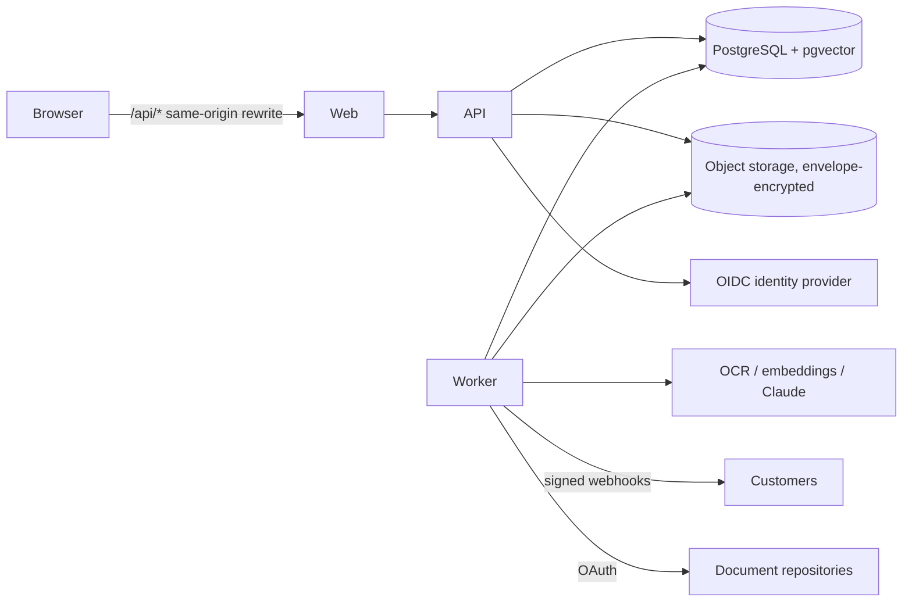
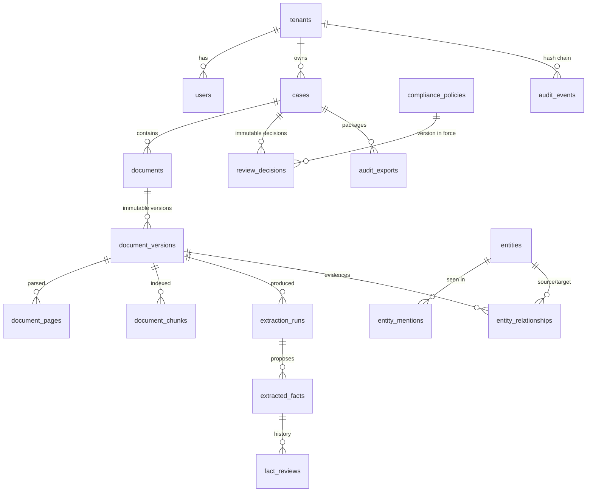
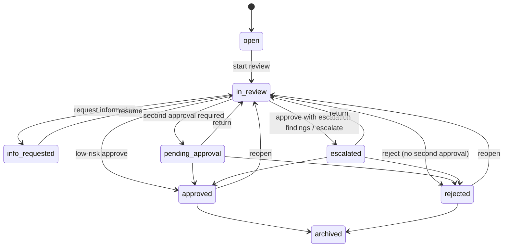

# Architecture

FinGraph is a modular monolith with asynchronous workers (requirements §10.1). One
TypeScript codebase produces three deployables:

| Process | Entry point | Scales by |
|---|---|---|
| API | `apps/api/src/main.ts` | Stateless; add replicas behind a load balancer |
| Worker | `apps/api/src/worker.ts` | Add replicas; jobs are claimed with `FOR UPDATE SKIP LOCKED` |
| Web | `apps/web` (Next.js standalone) | Stateless; add replicas |

In development `WORKER_INLINE=true` runs the worker, scheduler and outbox dispatcher
inside the API process, so a single `pnpm dev` is enough.

## Modules

Code lives in `apps/api/src/modules/<module>`. Each module owns its routes, SQL and
domain logic. Shared plumbing lives in `src/lib` (HTTP route helper, errors, crypto,
rate limit, idempotency, metrics) and `src/db` (database adapters and migrations).

| Module | Responsibility | Spec |
|---|---|---|
| `identity` | OIDC sign-in, sessions, CSRF, users, invitations, tenant settings, SCIM | IAM-01..05 |
| `audit` | Hash-chained audit events, verification, listing | GOV-01 |
| `cases` | Cases, references, assignment, members, checklists (versioned), requests, notes, timeline | CASE-01/02 |
| `documents` | Upload sessions, signed upload URLs, registration, versions, grants, downloads, file type detection, malware scanning | DOC-01/02/07 |
| `jobs` | Queue, worker, retries, dead letters, scheduler | DOC-03 |
| `ingestion` | Pipeline orchestration and stage records | DOC-03, §10.4 |
| `extraction` | Parsing, OCR, classification, schema extraction, fact review, reprocessing, batch import | DOC-04..06, DOC-08, CASE-03 |
| `graph` | Entities, relationship claims, resolution, reconciliation, traversal, ownership roll-up, discrepancies | KG-01..06 |
| `retrieval` | Chunking and indexing, hybrid search, grounded Q&A, comparison | AI-01..08 |
| `workflow` | Case state machine, policies, readiness, decisions | CASE-04, CASE-08 |
| `governance` | Evidence exports, share links, legal holds, retention, purge | CASE-06, GOV-02, GOV-04 |
| `notifications` | In-app notifications | CASE-07 |
| `metrics` | Dashboard, usage against quotas, operational alerts | CASE-05, GOV-03 |
| `integrations` | API clients, webhooks, OAuth connectors | INT-01..04 |
| `events` | Transactional outbox | §9.4 |

### Request lifecycle

1. `onRequest`: a correlation ID is taken from `X-Correlation-Id` or generated and
   echoed back. The caller is resolved from the session cookie or a bearer token.
2. `preHandler`: CSRF check for cookie-authenticated writes, then the rate limit
   (per principal and per route), then `Idempotency-Key` handling for POSTs.
3. The route helper (`lib/http.ts` `route()`) checks authentication, OAuth scopes
   for API clients and RBAC permissions *before* validating input with zod. Then
   the handler runs in `tx()`, a transaction that has `SET LOCAL ROLE fingraph_app`
   and `app.tenant_id` set, so Postgres row-level security limits every query to
   the caller's tenant.
4. Handlers check object-level access (case visibility, document grants) and
   return 404 for anything the caller may not see, so existence never leaks.
5. State changes write an audit event, and outbox events where relevant, in the
   **same transaction** as the change.
6. Errors are returned as `application/problem+json` (RFC 9457) with a stable `code`.

## Data model

All customer-owned tables carry `tenant_id` and are registered with
`fg_tenant_table()`, which enables **forced** row-level security and grants the
restricted application role. The main entities (requirements §8):

Design rules that the code relies on:

- **Versions are immutable.** A replacement upload creates a new `document_versions`
  row. It becomes `current_version_id` only once it has been processed successfully.
- **Derived data points at its source version.** That covers pages, chunks,
  extraction runs, facts, mentions, relationships and AI interactions
  (`source_versions`), so a purge can find everything derived from a document.
- **Assertions are the evidence-bearing records** (`entity_relationships`). Each one
  has an evidence document version, page, quote, confidence and review status, plus
  `valid_from`/`valid_to` for when it was true, kept separate from `created_at`
  (when FinGraph learned of it).
- **Reviewed facts are never silently changed.** Reprocessing supersedes unreviewed
  candidates and leaves approved, corrected and rejected facts alone.
- **Audit events and review decisions are append-only.** Database triggers block
  `UPDATE` and `DELETE`. The only exception is the retention purge, which uses an
  explicit `app.purge` flag.

Migrations are plain SQL in `apps/api/src/db/migrations`, applied in order by
`migrate()` on startup (or `pnpm --filter @fingraph/api migrate`).

## Ingestion pipeline

`POST /v1/documents` stores the upload as a version, enqueues an `ingest_document`
job and returns `202 Accepted` with a `status_url`. The worker runs these stages
(`jobs.ts` `ingestionStages()`):

| Stage | What it does | Persisted output |
|---|---|---|
| validate | Re-checks SHA-256, size, detected type vs declared | stage record |
| scan | Built-in signatures (EICAR, executables, PDF `/Launch`) or ClamAV; quarantines on a hit | `scan_result` |
| parse | pdf.js text with positions → lines, cells and tables; DOCX XML; CSV; OCR for images | `document_pages`, `document_tables` |
| classify | Weighted keyword rules; low confidence is flagged for review | `documents.category` |
| extract | Schema per category (labelled fields, ranges, tables) with page/char evidence | `extraction_runs`, `extracted_facts` |
| index | Line-boundary chunks with offsets, embeddings, `tsvector` | `document_chunks` |
| graph | Entities, mentions and relationship claims; temporal reconciliation | `entities`, `entity_relationships` |

Every stage writes a `job_stages` row with status, duration, processor name and
version, the input version and the error type. Retries resume after the last
completed resumable stage. A job is retried with exponential backoff up to
`max_attempts`, then dead-lettered. Permanent errors (unsupported or unreadable
files) fail immediately and are shown in the UI.

## Retrieval and grounded answers

`retrieval/search.ts` runs two candidate queries, full-text (`websearch_to_tsquery`
with `ts_rank_cd`) and vector (`<=>` cosine). Both include the authorization
predicate (`fg_document_visible`, current version, not deleted) inside the
`WHERE` clause, so inaccessible chunks are never scored. Results are fused with
reciprocal rank fusion. Chunks from documents that support case relationships get
a boost.

`retrieval/rag.ts` (WF-04):

1. Checks the tenant's daily AI token quota.
2. Retrieves passages and optionally adds relationship-graph statements (AI-07).
3. Drops passages that look like instructions to the model (prompt-injection screen)
   and flags the answer.
4. Calls the LLM provider with passages marked as untrusted data and a structured
   output schema (`status`, `claims[]` with passage citations, `missing`).
5. Validates the answer: claims must cite passages that exist, and the cited text
   must support the claim's terms. Unsupported claims are removed. If nothing
   remains, the answer becomes an abstention.
6. Logs the interaction with provider, model, prompt version, retrieval parameters,
   cited source versions, token usage and latency (AI-06).

Answers whose cited sources the reader can no longer see are hidden from history.
Purging a source redacts the answer.

## Knowledge graph

The graph is stored relationally (§4.3: "The MVP may represent graph relationships
in relational tables").

- **Direction convention:** `OWNED_BY` and `SUBSIDIARY_OF` point from the held entity
  to its holder. `DIRECTOR_OF` and `OFFICER_OF` point from the person to the company.
- **Resolution** (`graph/resolve.ts`): matching identifiers (EIN, file number) or an
  identical normalized name with no conflicting date of birth or identifier counts
  as the same entity. A near match (Jaro-Winkler ≥ 0.9) creates a new entity and a
  duplicate suggestion that a person merges or dismisses.
- **Reconciliation** (`graph/build.ts` `reconcileCase`): if two claims about the same
  pair have different dates, the newer one closes the older (`valid_to`). If they
  share a date but give different percentages, both are marked `conflicting` and
  kept.
- **Traversal** is breadth-first with caps on depth (4), nodes (200) and edges
  (1000), plus a statement timeout. Edges are only visible when their evidence
  document is visible.
- **Ownership roll-up** multiplies percentages along `OWNED_BY` chains to compute
  effective ownership. The `undeclared_beneficial_owner` discrepancy comes from
  comparing this against the ownership declaration.

## Workflow

The policy version stored on the case decides which findings force escalation,
which findings block approval, whether critical facts must be reviewed, and which
risk levels need a second approver. The approver must be a different person from
the reviewer. Each decision stores a snapshot of the checks and findings at that
moment.

## Events and integrations

Domain events (`document.processed`, `case.review_completed`, …) go to
`outbox_events` inside the business transaction. The `OutboxDispatcher` turns them
into `webhook_deliveries` plus `deliver_webhook` jobs. That gives at-least-once
delivery, HMAC signatures, retries with backoff, dead letters and automatic
disabling after 50 consecutive failures.

OAuth connectors (`integrations/providers.ts`) implement Authorization Code + PKCE,
encrypted token storage, refresh with rotation, revocation and resumable,
incremental sync. Files that change at the provider become new document versions.

## Frontend

The web app (`apps/web`) is a client-rendered Next.js App Router application. The
browser only talks to its own origin: `/api/*` is rewritten to the API, so session
cookies stay first-party. Data fetching uses TanStack Query; `lib/api.ts` adds the
CSRF header and turns problem details into `ApiError`. The design system lives in
`src/ui` and is documented in [DESIGN.md](DESIGN.md). Its signature component is
`SourcePage`, which renders extracted page text in the document's serif voice with
evidence spans highlighted.

## Key decisions

See [adr/](adr) for the reasoning behind the bigger choices.

| ADR | Decision |
|---|---|
| [0001](adr/0001-modular-monolith.md) | Modular monolith plus workers in TypeScript |
| [0002](adr/0002-postgres-everything.md) | Postgres for relational data, queue, full-text, vectors and graph |
| [0003](adr/0003-row-level-security.md) | Tenant isolation through forced row-level security as well as application checks |
| [0004](adr/0004-pluggable-ai-providers.md) | Pluggable AI providers with deterministic local defaults |
| [0005](adr/0005-evidence-first-ui.md) | Evidence-first interface: every value links back to its source span |

## Known limitations

- PDF pages without a text layer (scanned PDFs) are marked unreadable and raised as
  a finding. Image uploads are OCR'd, but rasterizing scanned PDF pages for OCR is
  not implemented yet.
- The built-in malware scanner is a baseline. Enable ClamAV (`MALWARE_SCANNER=clamav`)
  or a managed scanner in production.
- The local embedding and answer providers are deterministic stand-ins for
  development and testing. Production deployments should configure Voyage
  embeddings and Claude.
- Rate limiting is in-process. Use a shared store (Redis) when running several API
  replicas.
