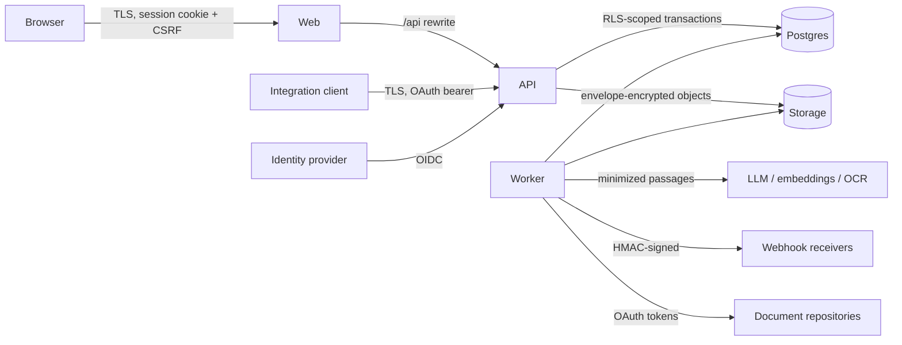

# Security guide

FinGraph handles beneficial-ownership data, tax identifiers, account details and
confidential corporate records. This document describes the threat model, the
controls that are in place, and the operator responsibilities.

## Trust boundaries

Customer documents are **untrusted input**. They pass through file-type detection,
scanning and parsing, and they reach the language model only as quoted data.

## Controls (requirements §12.2)

| Control | Implementation | Where |
|---|---|---|
| Identity | OIDC Authorization Code + PKCE (S256), `state`, `nonce`, issuer and `iss` checks (RFC 9207), signature validation via JWKS, server-side code exchange | `identity/oidc.ts`, `auth-routes.ts` |
| MFA | Tenant policy `require_mfa` checks the `amr` claim (RFC 8176); sessions without a second factor are refused | `auth-routes.ts` |
| Sessions | Random 256-bit token; only its SHA-256 is stored. httpOnly, SameSite=Lax, Secure in production. Idle and absolute expiry. Revoked on logout, deactivation and SCIM deprovisioning. Optional IP allowlist | `identity/sessions.ts` |
| CSRF | Double-submit token required on every cookie-authenticated `POST/PUT/PATCH/DELETE` | `auth-routes.ts` hook |
| Authorization | RBAC (`packages/shared/src/rbac.ts`) is checked before input validation. Object-level checks for case visibility (restricted cases, members) and document grants. Not-visible returns 404 | `lib/http.ts`, `cases/access.ts`, `documents/access.ts` |
| Tenant isolation | Forced row-level security on every tenant table. Requests run as the non-privileged `fingraph_app` role with `app.tenant_id` set. Search, graph, AI and exports reuse the same visibility predicates | migrations, `db/index.ts` |
| Separation of duties | The approver must differ from the reviewer. Export approval by someone other than the requester. Last-admin protection | `workflow/routes.ts`, `governance/routes.ts` |
| Encryption | TLS in transit (deployment). Objects: per-object AES-256-GCM data key wrapped with a key-encryption key, object key bound as AAD. Connector tokens and tenant IdP secrets: AES-256-GCM | `storage/index.ts`, `lib/crypto.ts` |
| Secrets | From environment or secret manager. Never logged: pino redacts auth headers, cookies and CSRF. API client, SCIM, invitation, share and session tokens are stored as hashes and shown once | `app.ts` |
| Documents | Declared vs detected type must match. Size limits. Malware scanning with quarantine, which blocks download. PDF active content flagged. Downloads use `Content-Disposition: attachment`, a sandbox CSP and `nosniff` | `documents/*` |
| Upload URLs | HMAC-signed, 15-minute expiry, single use, bound to a tenant upload session | `documents/routes.ts` |
| API | Zod validation, rate limits per principal and per route, `Idempotency-Key`, problem+json errors without stack traces, OpenAPI | `lib/*` |
| Audit | Append-only (trigger-enforced) and hash-chained per tenant. `GET /v1/audit/verify` recomputes the chain. Reads of documents, downloads and AI questions are audited | `audit/service.ts` |
| AI | Authorization before retrieval, prompt-injection screening, untrusted-data prompting, citation validation, abstention, structured output, per-tenant token quotas, full provenance log | `retrieval/rag.ts`, `ai/llm.ts` |
| Webhooks | HMAC-SHA256 signature with timestamp, event IDs for deduplication, SSRF protection (https only, private ranges and metadata IPs blocked in production), redirects not followed, automatic disabling after repeated failures | `integrations/webhooks.ts` |
| Connectors | PKCE, single-use state with 10-minute expiry, read-only scopes, encrypted tokens, refresh rotation, provider-side revocation on disconnect | `integrations/connections.ts` |
| Browser | `X-Frame-Options: DENY`, `nosniff`, strict referrer policy, permissions policy, no `dangerouslySetInnerHTML`; search highlights are rendered as React elements | `next.config.ts` |

## RAG-specific threats (§12.3)

| Threat | Mitigation | Verified by |
|---|---|---|
| Prompt injection in documents | Passages that look like instructions are withheld and the answer is flagged. Passages are delimited and described as data. Claims must be supported by the cited text | `test/rag.test.ts` "withholds passages…", evaluation question `a1` |
| Source poisoning | Every claim shows its source. Graph statements carry their verification status. Reviewers see conflicting claims instead of a merged value | discrepancy tests |
| Cross-tenant vector leakage | Vector and keyword candidates are filtered by tenant (RLS) and document visibility inside the SQL, before ranking | `test/rag.test.ts` "never returns restricted or other-tenant documents" |
| Unauthorized graph traversal | An edge is visible only if its evidence document is visible. Entity pages require a visible mention | `test/graph.test.ts` |
| Stale access after a permission change | Visibility is evaluated per request. AI history hides answers whose sources are no longer visible | `test/rag.test.ts` |
| Deletion gaps | Purge removes chunks, embeddings, pages, facts, claims, mentions and orphaned entities, and redacts AI answers that cited the document | `test/governance.test.ts` |

## Security testing

- `test/security.test.ts` enumerates every route in the OpenAPI document. It calls
  each one as a fully privileged user from another organization, using real IDs,
  and fails on any 2xx, 409 or 5xx response, or any response containing the other
  tenant's data. It also checks that every non-public route requires
  authentication.
- `test/identity.test.ts` covers forged, replayed and mismatched OIDC responses,
  open redirects, MFA, idle expiry, CSRF and deactivation.
- `test/api.test.ts` covers forged and revoked bearer tokens, scope enforcement and
  idempotency.
- `test/webhooks.test.ts` covers signature verification and SSRF blocking.

## Operator responsibilities

- Run the API as a database role that is **not** the table owner, or keep
  `FORCE ROW LEVEL SECURITY` (the migrations set it) and never connect application
  traffic as a superuser outside `SET ROLE` scopes.
- Use your own IdP with MFA enforced. The bundled sandbox is for development only.
- Store `APP_SECRET`, `ANTHROPIC_API_KEY`, `METRICS_TOKEN` and OAuth client
  secrets in a secret manager.
- Enable ClamAV or a managed scanner. The built-in scanner is a baseline.
- Review the data-processing terms of any AI provider. FinGraph sends only the
  passages needed for a question. Customer data must not be used for model training
  without permission (§11).
- Keep dependencies patched (`pnpm audit`, Dependabot) and review access every quarter.

## Compliance boundary

FinGraph collects and organizes evidence. Approving a customer remains a decision
made by authorized people under the institution's own program (BSA/AML CDD, GLBA,
GDPR and others as applicable). Policies in FinGraph are configurable and versioned
so that legal and compliance teams can encode their procedures. They are not legal
advice, and the defaults must be reviewed before use.

## Reporting a vulnerability

Email the security contact listed in your deployment's `SECURITY.txt` with steps to
reproduce. Do not include real customer data.
